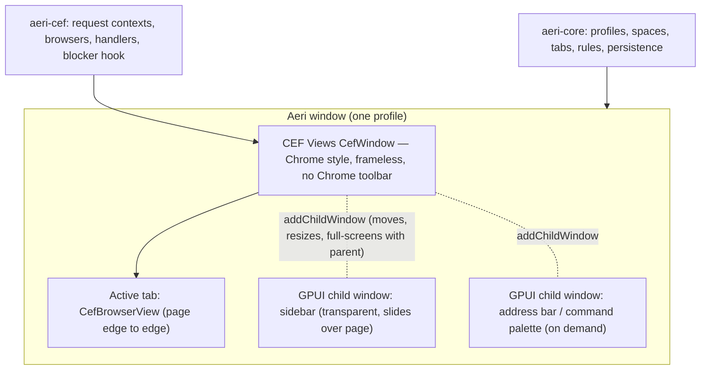

# Tech stack — Aeri

Status: **approved** 2026-11-18 (owner), except codecs/DRM, which is being
researched at the owner's request (`docs/research/codecs-drm.md`).
Evidence: `docs/research/gpui.md`, `docs/research/cef.md`,
`docs/research/blocking-and-credentials.md` (all 2026-11-18, primary sources,
labelled Observed / Reported / Inferred). Requirements:
`01-business-logic.md` (approved).

## Summary

| Component | Choice | Why — over what |
| --- | --- | --- |
| Language | Rust (stable, edition 2024) | Required by owner; GPUI, cef-rs and adblock-rust are all Rust — over Swift (Mac-only, splits the codebase before Windows) |
| Web engine | Chromium via CEF, stable channel, binary builds from the Spotify CDN | The only way to get Chrome site behaviour *and* Chrome Web Store extensions without forking Chromium — over a Chromium fork (non-goal, Helium-sized build cost), system WebKit (Search's route: tiny and light, but no Chrome compatibility) |
| Engine binding | `cef` crate (tauri-apps/cef-rs) 156.x, C-API based, `CEF_API_VERSION` pinned | Current (tracks CEF stable within days), Apache-2.0/MIT, ships the macOS bundler and sandbox loader — over a hand-written C/ObjC++ shim (more unsafe code to own) and `wef`/`tanso` (abandoned / single-consumer) |
| How pages meet the UI (macOS) | **Each Aeri window is a frameless Chrome-style CEF Views window filled edge to edge by the page; GPUI draws Aeri's interface in transparent child windows attached above it** (option B) — gated by spike S1 | Chrome style is the only style with Web Store install, extension popups, passkey and permission prompts; on macOS Chrome style cannot live inside another app's view (CEF source, issue #3294) — over Alloy-in-GPUI (extensions run but `tabs.query` is empty, no popups, no store install: breaks the password-manager extensions) and off-screen rendering (Alloy too, plus a CPU copy per frame) |
| Native UI | GPUI, git dependency pinned to a `zed-industries/zed` commit | Owner's choice; draws only when something changed (macOS 14+ display link pauses when idle), solid IME/text input, transparent windows, springs — over `gpui-pre` snapshots (third-party publisher) and crates.io `gpui` 0.2.2 (13 months stale) |
| Platform glue | `objc2` + `objc2-app-kit` (macOS), `windows` crate (Windows) | Already in GPUI's and cef-rs's dependency trees; keeps everything in Rust — over Swift/ObjC++ bridges (second toolchain, nothing they do that objc2 can't) |
| Aeri's own data | SQLite via `rusqlite` (bundled), one `app.db` + one `profile.db` per profile, WAL, migrations in code | Local-first, transactional, one file per profile makes deletion and isolation trivial — over separate history/bookmarks/session DBs (more files, no gain) and JSON files (no transactions, slow history search) |
| Content blocking | `adblock` (brave/adblock-rust) 0.13 in the browser process; requests checked in CEF's `OnBeforeResourceLoad`; cosmetic CSS injected from the renderer helper; lists downloaded at runtime | ~3.9 µs per request and ~9 MB for one engine shared by every profile (measured) — over uBlock Origin Lite as the built-in (weaker rules, a copy per profile); classic uBO is dead on current Chromium |
| Secrets (Aeri's basic store) | `keyring-core` + `apple-native-keyring-store` (data-protection Keychain) / `windows-native-keyring-store` | OS-protected, MIT/Apache, maintained — over storing ciphertext in SQLite (key management becomes ours) |
| Diagnostics | `tracing` + `tracing-subscriber` to a local rotating file; nothing leaves the machine | Structured, per-profile spans; no telemetry by rule |
| Errors | `thiserror` in libraries, `anyhow` at the app edge | Explicit, typed errors where callers branch on them |
| Build and packaging | Cargo workspace; cef-rs `bundle-cef-app`; our own `scripts/sign-macos.sh` (inside-out signing, hardened runtime, notarisation) | cef-rs has no signing step (Observed) — over CMake (unneeded; no C++ of our own) |
| CI | GitHub Actions, macOS arm64 runners (Windows added in the Windows phase) | Open-source default; CEF binaries cached between runs |

## Runtime

Rust stable, edition 2024. One app process (the CEF browser process, which
also runs GPUI and Aeri's core) plus Chromium's helper processes (GPU, network,
storage, renderers, extensions). The helper executable is a small Rust binary
that only runs CEF's subprocess entry and Aeri's renderer-side hooks (cosmetic
filtering). Many profiles and windows run inside this one process tree; a
second launch hands its request to the running app (CEF's process-singleton
lock on the root cache path already enforces this).

Main thread: GPUI owns `[NSApp run]`. CEF runs with `external_message_pump`;
`OnScheduleMessagePumpWork` arms a Core Foundation timer/source in the
common and event-tracking run-loop modes that calls `CefDoMessageLoopWork`
outside any GPUI borrow (pattern proven by bokuweb/gpui-cef; CEF's own
sample pump uses the same modes). `CefAppProtocol` is added to GPUI's
`NSApplication` subclass at runtime via objc2.

## Framework

**Window model (macOS, option B).**

- One `CefRequestContext` per profile, `cache_path = <root>/<profile-id>`.
- Tabs are `CefBrowser`s; the window shows one `CefBrowserView` at a time and
  Aeri swaps the active one (a Chrome-style window hosts at most one Chrome
  browser view — swap feasibility is in spike S1).
- Pinned sidebar: the CEF content is inset and the GPUI window sits beside it.
  Hidden sidebar: the GPUI window slides over the page; transparent areas pass
  clicks through to the page.
- Extension buttons and popups, the Web Store install prompt, permission
  prompts and passkey sheets are Chrome's own UI, positioned by Aeri.
- **Fallback if S1 fails:** option C (GPUI view added inside the CEF window),
  then option A (Alloy browsers inside GPUI + Aeri-built install and popup
  UI). A changes the first-release extension promise and needs owner approval.

**Windows (later phase):** Chrome style accepts a parent `HWND` on Windows
(CEF source), but a child window covers GPUI drawing and GPUI has no external
GPU-surface path there. The same child-window layering is the starting
assumption; it gets its own spike in the Windows phase.

**Engine seam.** `aeri-core` defines the commands it issues (create/close
browser, navigate, go back/forward, reload, stop, rest, show) and the events
it consumes (load state, title, favicon, navigation entries, crash, popup
request, permission request, download, certificate error). `aeri-cef`
implements them. No CEF type crosses into `aeri-core` or the UI.

## Data

- `~/Library/Application Support/Aeri/` (Windows: `%LOCALAPPDATA%\Aeri\`):
  - `app.db` — profiles list (stable ids, name, colour, avatar), appearance,
    themes, shortcut map, filter-list metadata, window placement.
  - `Profiles/<profile-id>/profile.db` — spaces, favourites, tabs, navigation
    trails, closed tabs, history, bookmarks, site settings and permissions,
    certificate-exception log, downloads list, password-provider choice.
  - `Chromium/` — CEF `root_cache_path`; `Chromium/<profile-id>/` is each
    profile's Chromium storage (cookies, cache, site data, extensions).
    CEF requires profile caches to be direct children of the root.
  - `Blocking/` — downloaded filter lists and the serialised engine cache.
- Deleting a profile = close its windows, release its request context, delete
  `Profiles/<id>/`, `Chromium/<id>/` and its Keychain items.
- Migrations: numbered SQL in code, applied at open, `user_version` pragma.
- All database work runs on GPUI's background executor; the UI never waits
  on disk.
- Themes and shortcut maps import/export as JSON files (schema-validated;
  look-only fields).

## Infra and deploy

- Signed, notarised `.app` in a DMG for Apple Silicon (macOS 14+, so GPUI's
  idle-pausing display link is always used).
- CEF tracking: follow CEF stable; pin `CEF_API_VERSION`; ship a new framework
  with each Chromium security release (roughly monthly).
- Updates: signed update feed (mechanism chosen in the beta phase).
- Apple entitlement `com.apple.developer.web-browser.public-key-credential`:
  apply early (organisation Account Holder). It enables iCloud Keychain
  passkeys **and** is what lets Aeri launch Apple's Passwords helper.
- Chromium credits/notices shipped per build; `cargo-deny` licence and
  advisory checks in CI.

## Key libraries

- `cef` (cef-rs) — CEF bindings, bundler, sandbox loader.
- `gpui` (zed, pinned commit) — native UI.
- `adblock` 0.13 — filter-list engine (MPL-2.0, used unmodified).
- `rusqlite` (bundled) — SQLite.
- `keyring-core`, `apple-native-keyring-store`, `windows-native-keyring-store`
  — OS secret storage.
- `objc2`, `objc2-app-kit`, `objc2-foundation` — AppKit glue.
- `serde`, `serde_json` — theme/shortcut files, list metadata.
- `tracing`, `tracing-subscriber`, `thiserror`, `anyhow`.
- `uuid` (v7) — stable profile/space/tab ids.

## Workspace (starting shape)

- `apps/aeri` — the binary: GPUI windows and views, macOS glue.
- `apps/aeri-helper` — CEF subprocess binary (renderer hooks).
- `crates/aeri-core` — domain model, rules, state machines, persistence.
  No GPUI, no CEF.
- `crates/aeri-cef` — CEF adapter implementing the engine seam, plus the
  blocker hook.

More crates only when an ownership boundary appears (handoff §9).

## Rejected alternatives

- **Alloy-style browser inside GPUI's view (option A)** — extension runtime
  works, but no `tabs`/`windows` APIs, no popups, no Web Store install, no
  passkey UI; password-manager extensions depend on these. Kept as fallback.
- **Off-screen rendering into GPUI** — Alloy-only (same extension gap), a CPU
  copy per frame (~24 MB/frame at Retina full screen), no smooth scrolling,
  and Aeri re-owns input and IME.
- **Patched/self-built CEF (option E)** — fixes embedding and codecs but makes
  Aeri own a Chromium build pipeline with monthly rebases. Revisit only for
  codecs/DRM (see open decision).
- **Chromium fork (Helium's route)** — non-goal.
- **System WebKit (Search's route)** — lightest by far, but not Chrome.
- **uBlock Origin Lite as the built-in blocker** — weaker rule set, cost per
  profile; remains installable by the Person.
- **gpui-fast fork for overlays** — third-party fork with unmerged
  composition API; unnecessary if child windows work.

## Owner decisions (2026-11-18)

1. **Video codecs and DRM — pending.** Standard CEF builds cannot play
   H.264/AAC video or Widevine DRM (Observed in a probe). The owner needs
   them and asked for workarounds; research is in progress and the choice
   (self-built CEF with codecs, OS decoders, Widevine licence route) will be
   added here for approval before stage 3 closes.
2. **Apple developer account: individual.** Apple grants the browser
   passkey entitlement only to organisation accounts. Consequences until an
   organisation account exists (needs a legal entity and a D-U-N-S number):
   no iCloud Keychain passkeys, and no Apple Passwords (macOS refuses to start
   Apple's helper for an app without the entitlement — Observed). Security
   keys still work and phone passkeys probably do (Inferred, untested).
   Nothing else in the stack depends on it.
3. **Mac password default:** Apple Passwords via Apple's official extension
   once the entitlement is granted. Until then, and on Windows, the default
   is Aeri's basic store in the Keychain / Credential Manager. Password-
   manager extensions are available from day one.
4. **Filter lists:** downloaded at first launch, nothing bundled.

## ADRs raised

- `docs/decisions/0001-browser-engine.md` — Chromium via CEF + cef-rs.
- `docs/decisions/0002-rendering-strategy.md` — Chrome-style Views window with
  GPUI child windows (option B), spike-gated, fallbacks C then A.
- `docs/decisions/0003-content-blocking.md` — adblock-rust in the browser
  process, runtime lists.
- `docs/decisions/0004-profile-storage.md` — request context + per-profile
  SQLite + layout above.

(ADRs live in `docs/decisions/` per the handoff, not `.monozukuri/decisions/`,
to keep one convention in a public repo.)

## Spikes this stack depends on (run first in the phase plan)

- **S1 Layering:** frameless Chrome-style Views window + transparent GPUI
  child window: slide over page, click-through, live resize, full screen,
  focus hand-off, tab swap between browser views.
- **S2 Web Store:** install uBO Lite and Bitwarden end to end in a non-default
  profile; persists across restart; popup opens without a Chrome toolbar.
- **S3 Run loop:** CEF external pump inside GPUI's app: live resize, menus,
  sheets, clean shutdown with N profiles (no orphan helpers).
- **S4 Profile cost and isolation:** 1/2/5/10 request contexts — memory per
  process type, startup per profile, cookies/storage do not cross, dormant
  profile returns memory.
- **S5 Blocking hook:** adblock-rust in `OnBeforeResourceLoad` — per-request
  latency on a page corpus; cosmetic injection timing.
- **S6 Passwords (found in stage 3):** Chrome's own password manager in
  Chrome-style CEF without a toolbar vs a renderer-hook save/fill.
- **S7 Background (found in stage 3):** hidden-view throttling and an
  audible-tab signal in Chrome-style CEF.
